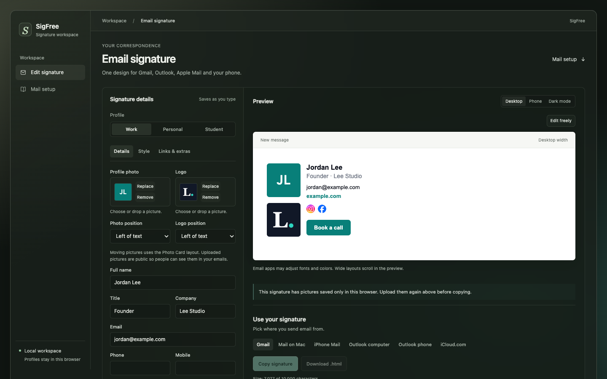

# SigFree



SigFree is a free email signature maker that runs on your own computer.

- **Profiles:** keep separate signatures, like Work, Personal and Student, and switch with one click.
- **Photo Card:** your photo and logo next to your details, with adjustable width, picture sizes, spacing, border and picture positions.
- **Edit freely:** type, format text and move pictures right in the preview.
- **Copy steps for each mail app:** Gmail, Apple Mail, iPhone Mail, Outlook and iCloud.com, each with the right copy button.
- **Chrome add-on for iCloud.com:** iCloud.com only saves text signatures, so the add-on adds the full signature, pictures included, to each new email. Open `chrome://extensions`, turn on Developer mode, click Load unpacked and pick the `extension` folder.

## Run it

```sh
npm install
npm run build
npm start
```

Then open http://127.0.0.1:8793.

Picture uploads need macOS and the GitHub CLI (`gh`) signed in.

Privacy: your profiles stay in your browser. Pictures you upload and the social icons are stored in a public GitHub repo so email apps can show them. Set that repo at the top of `scripts/server.mjs`.

License: MIT
